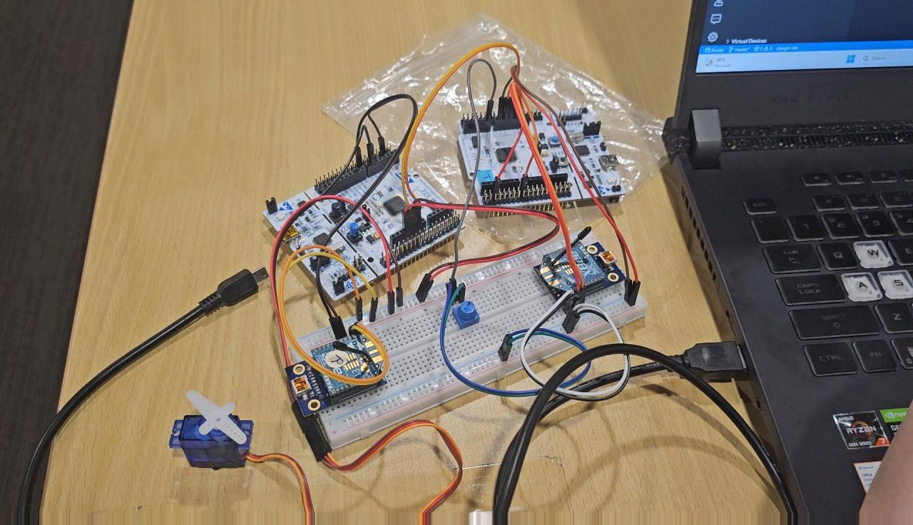
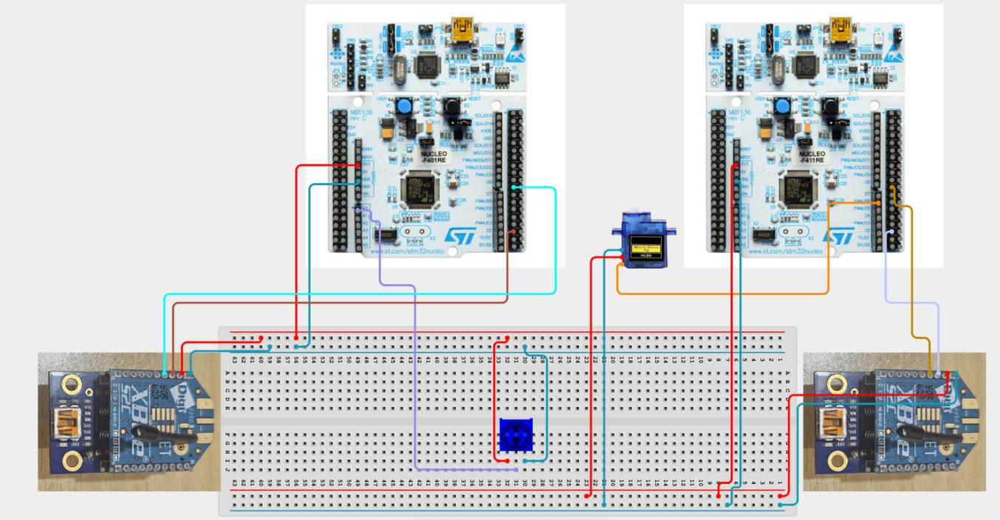
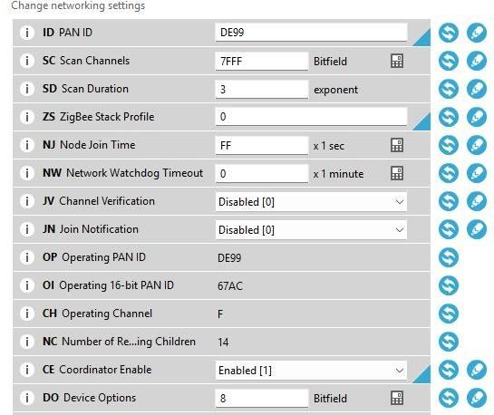
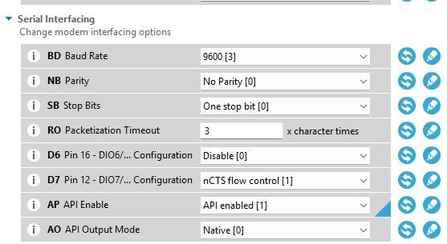

# Zigbee Package Priority Sorter — Two STM32 Nucleos over Encrypted XBee

A wireless link for a delivery-robot scenario. A courier turns a dial on **MCU A** to set a parcel's priority (Standard, Express or Urgent). The priority and a package ID are sent as a **single byte** over an **encrypted Zigbee network** (XBee S2C in API mode) to **MCU B**, which moves a **servo** to the sorting lane for that priority.

<p align="center"></p>

## How it works

```
MCU A (sender, Router)                                       MCU B (receiver, Coordinator)
┌──────────────────────────────┐   encrypted Zigbee (API)   ┌──────────────────────────────────┐
│ pot → average 10 samples     │                            │ byte-by-byte API frame parser    │
│ → fuzzify into 3 priorities  │  0x10 Transmit Request ──▶ │ (0x90 Receive Packet)            │
│ → pack 1-byte payload        │   [0xDA marker][payload]   │ → verify checksum + 0xDA marker  │
│ → build API frame + checksum │                            │ → unpack priority + package ID   │
│   once per second            │                            │ → servo 1000/1500/2000 µs, LED   │
└──────────────────────────────┘                            └──────────────────────────────────┘
```

### 1. Fuzzification: dial → priority
MCU A averages 10 ADC samples to cut down noise, then sorts the result into one of three bands:

| Pot reading (0–4095) | Priority | Code | Servo pulse at MCU B |
|---|---|---|---|
| 0 – 1365 | Standard | `00` | 1000 µs |
| 1366 – 2730 | Express | `01` | 1500 µs |
| 2731 – 4095 | Urgent | `10` | 2000 µs |

The servo goes to a fixed position for each category. It doesn't follow the dial directly, so each position clearly means one lane.

### 2. A one-byte payload
```
 bit:   7   6 | 5   4   3   2   1   0
      priority|     package ID (0–63)
```
Two bits hold 3 priorities, with one value spare for later. Six bits count up to 64 packages before wrapping. Fitting both into one byte keeps each radio frame as short as Zigbee API mode allows. Of the 20 bytes in each frame, 18 are API overhead and 2 are useful data: a `0xDA` marker plus the payload.

### 3. Building the frame (MCU A)
`CreateMessage()` builds a 20-byte **API 0x10 Transmit Request** frame byte by byte: the start delimiter `0x7E`, length `0x0010`, frame type, the coordinator as the 64-bit destination address, radius and options, then the marker and payload. It finishes with the XBee checksum (`0xFF −` the low byte of the sum of the frame data).

### 4. Parsing the frame (MCU B)
A **state machine** reads the incoming bytes one at a time: `SEARCH_START → READ_LEN_MSB → READ_LEN_LSB → READ_FRAME_DATA → READ_CHECKSUM`. A frame is only used if:
- its length is plausible (13 to 63 bytes),
- its checksum matches,
- it is a **0x90 Receive Packet**, and
- it carries the `0xDA` marker.

Anything else is dropped, and a failed checksum prints `Checksum FAIL`. The parser then goes back to looking for the next `0x7E`, so it recovers after line noise. For each valid frame, MCU B moves the servo, toggles its LED, and logs the result over USB:
```
[MCU B RX] priority=2 (Urgent) pkgId=37 payload=0xA5
```

## Hardware

| | MCU A (sender) | MCU B (receiver) |
|---|---|---|
| Board | NUCLEO-F401RE | NUCLEO-F401RE |
| XBee S2C | DIN ← `PA_9` (TX), DOUT → `PA_10` (RX), 3.3 V | DIN ← `PA_9` (TX), DOUT → `PA_10` (RX), 3.3 V |
| I/O | Potentiometer wiper → `A0` (3.3 V / GND on the ends) | Servo signal ← `D6` (PWM, 50 Hz) |
| Debug | USB serial 9600 baud | USB serial 9600 baud |

<p align="center"></p>

## XBee configuration (XCTU)

| Setting | Router (MCU A) | Coordinator (MCU B) |
|---|---|---|
| Firmware | Zigbee **API** | Zigbee **API** |
| `AP` API Enable | 1 | 1 |
| `BD` Baud rate | 9600 | 9600 |
| `ID` PAN ID | `DE99` | `DE99` |
| `CE` Coordinator Enable | 0 | **1** |
| `EE` Encryption Enable | **1** | **1** |
| `KY` / `NK` keys | same key on both radios | same key on both radios |

Set your own encryption key, and keep it out of the repo and screenshots.

| Networking | Serial interfacing |
|---|---|
|  |  |

## Building and running

1. Configure both XBees in **XCTU** as in the table above, and click **Write** on each.
2. In Keil Studio Cloud or Mbed Studio, create two **Mbed OS 6** projects for NUCLEO-F401RE. Use [`mcu_a_sender/main.cpp`](mcu_a_sender/main.cpp) in one and [`mcu_b_receiver/main.cpp`](mcu_b_receiver/main.cpp) in the other.
3. Flash both boards, then open MCU B's serial monitor at 9600 baud. Turn the potentiometer on MCU A, and the servo should jump between the three positions about once a second.

## Problems I hit and how I fixed them

| Problem | Cause | Fix |
|---|---|---|
| MCU A transmitted but MCU B received nothing | The firmware sent a raw byte, but the XBee in API mode only accepts data wrapped in an API frame | Rewrote the sender to build a proper 0x10 API frame with a checksum |
| The two XBees wouldn't join each other | Mismatched XCTU network settings | Reconfigured both radios from scratch with the same PAN ID, keys and roles |

## Limitations
- Data only flows from MCU A to MCU B, with no acknowledgement back. The frame ID is `0`, so the sending XBee doesn't report whether delivery succeeded.
- Both boards run `verify_secure_join()` at startup to query `EE`, but `main()` doesn't use its result. The firmware carries on whatever the answer is, so the radio configuration is what actually guarantees encryption.

## Context

Built for **6FTC2060 Robotic Communications** (BEng Robotics and Artificial Intelligence, University of Hertfordshire, delivered at PSB Academy, Singapore). The brief asked for effective Zigbee wireless communication between two microcontrollers for a robotic service application.

## Author

**Steve Flinston** ([@steveerobotclubsmt-create](https://github.com/steveerobotclubsmt-create))
